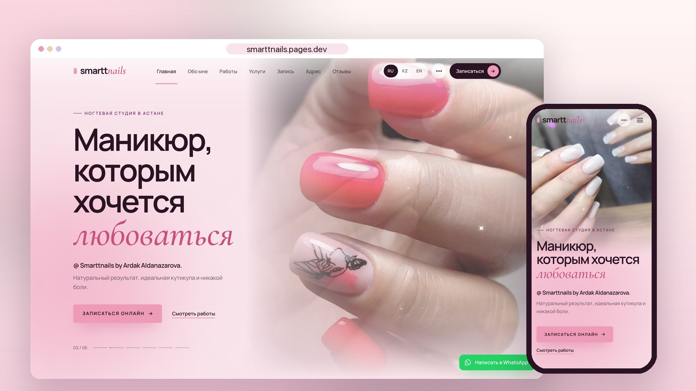

# Smarttnails — nail studio website

Website for **Smarttnails by Ardak Aldanazarova**, a nail artist in Astana, Kazakhstan.
Clients see the works and prices and book on WhatsApp in a couple of taps — comfortably from a phone.

**Live:** [smarttnails.pages.dev](https://smarttnails.pages.dev) · KZ / RU / EN



## Features

- **WhatsApp booking** — an iPhone mockup with a live chat animation; service buttons open WhatsApp with a ready-made message.
- **Price calculator** — pick services, the total is counted automatically and sent to WhatsApp as one message (on mobile the total sits in the bottom bar).
- **Live gallery** — 40 works with filters (nude, French, design, bright, pedicure); the marquee drifts on its own and slows down on hover.
- **Hero slideshow** with parallax, a soft preloader and scroll-triggered reveals.
- **Bento "About me"**, real client reviews, map, FAQ.
- **Background music** on a button, with a smooth fade via the Web Audio API.
- **Three languages** — Kazakh, Russian and English.
- **SEO** — sitemap with hreflang, canonical URLs, JSON-LD business card (`NailSalon`), OpenGraph link previews; connected to Google Search Console and Yandex Webmaster.
- **Mobile-first** layout, checked on phone, tablet and desktop.

## Tech stack

- [Nuxt 4](https://nuxt.com) (Vue 3, Composition API) + TypeScript
- [Tailwind CSS 4](https://tailwindcss.com)
- [GSAP](https://gsap.com) + ScrollTrigger
- [@nuxtjs/i18n](https://i18n.nuxtjs.org)
- Static generation (SSG), hosted on [Cloudflare Pages](https://pages.cloudflare.com)

## Getting started

```bash
npm install
npm run dev        # http://localhost:3010
npm run generate   # static site in .output/public
npm run deploy     # build for smarttnails.pages.dev and upload to Cloudflare Pages
```

All studio data — contacts, address, services and prices, gallery — lives in [`app/data/salon.ts`](app/data/salon.ts); texts are in [`i18n/locales`](i18n/locales).

## Credits

- Photos — works of Ardak Aldanazarova, used with permission.
- Music — "Deep House Sunset" by sunset-house-grooves, [Pixabay](https://pixabay.com/music/soft-house-deep-house-sunset-538759/) (Pixabay Content License).
- Design & development — [Onege Alibek](https://portfolio-vue-j15o.vercel.app/).
